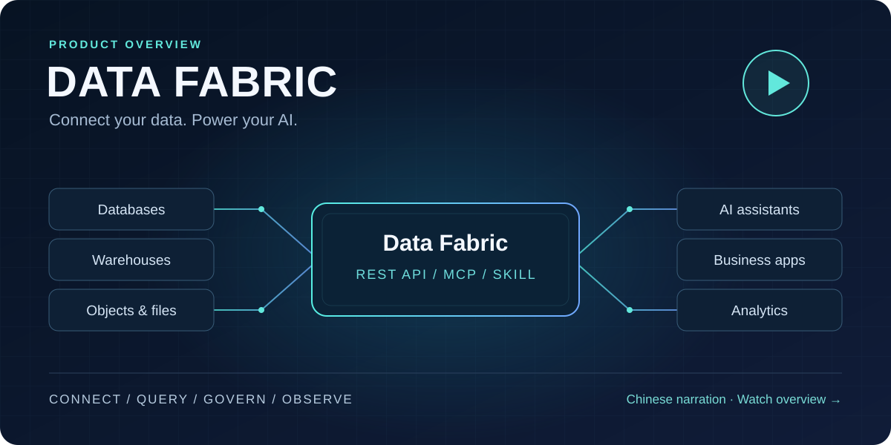
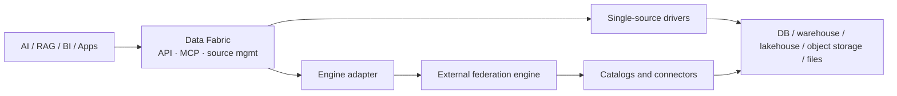

# Data Fabric — Lightweight AI Data Access Gateway

<div align="center">
  
  <p><strong>One lightweight gateway so AI apps can query many enterprise data sources through a shared SQL API — including MCP.</strong></p>
  <p>
    <a href="README_zh.md">简体中文</a> ·
    <a href="#quick-start">Quick Start</a> ·
    <a href="MCP_SERVER.md">MCP</a> ·
    <a href="docs/data-source-support.md">Connector catalog</a> ·
    <a href="https://github.com/RhinoLink-Tech/data-fabric">Star</a>
  </p>
  <p>
    
    
    <a href="https://github.com/RhinoLink-Tech/data-fabric/actions/workflows/go.yml"></a>
  </p>
</div>

**For:** AI agents, RAG, Text-to-SQL, and analytics assistants that need read access to mixed databases, warehouses, lakehouses, object storage, and files.

**Not:** a warehouse, ETL platform, vector store, or model / orchestration layer. Data stays in the systems you already run.

## Why teams use it

| Pain | What Data Fabric does |
| --- | --- |
| Every AI feature invents its own connectors and credentials | Register sources once; apps query through one API |
| Model SQL dialects do not match every engine | Optional translation inside the documented [SQL v1 contract](SQL_TRANSLATION_FEATURES.md) |
| Agents need a safe tool surface | Optional [MCP server](MCP_SERVER.md) for discover → validate → query → fetch batches |
| Cross-source SQL is optional, not default | Single-source drivers by default; plug in Trino / Presto / OpenLooKeng when needed |

## Product overview video

[](https://scrimba.com/explain/guide0ui5us658?fullscreen=1)

Explore deployment, data-source management, unified queries, access policies, observability, and MCP/Skill integration with Codex and WorkBuddy. This illustrated product overview has Chinese narration; follow the [deployment guide](docs/mcp-deployment.md) and [client setup guide](docs/agent-skill.md) for configuration steps.

## AI application scenarios

- **AI agents:** MCP over local stdio or authenticated Streamable HTTP — discover sources, validate read-only SQL, run queries, fetch batches. Release-mode remote MCP requires OIDC. See the [MCP guide](MCP_SERVER.md) and [agent skill notes](docs/agent-skill.md).
- **RAG retrieval:** Pull structured / semi-structured records from registered sources. Chunking, embeddings, and ranking stay in your RAG stack.
- **Text-to-SQL:** Route model-generated read-only SQL through one API; translate only within the published compatibility matrix.
- **AI analytics:** Give assistants one entry point; attach a federation engine only for cross-source SQL.

Example: [DeepSeek function-calling](examples/deepseek-agent/README.md).

## How it fits

| Component | Responsibility |
| --- | --- |
| Data Fabric | App-facing API, source lifecycle, diagnostics, query routing, result retrieval |
| Federation engine (optional) | Cross-catalog planning and execution |
| Source systems | Store and manage the data |



## Capabilities

- Data-source lifecycle: create, inspect, update, activate, deactivate, delete
- Driver registry for extending source types
- Connection tests, config validation, pool stats, health checks
- Unified query API with batched (and streaming-capable) result retrieval
- SQL dialect adaptation within the [SQL v1 matrix](SQL_TRANSLATION_FEATURES.md)
- Security: JWT APIs, OIDC for remote MCP, owner/tenant and table/column policies, redacted audit events, read-only SQL validation, TLS verification for PostgreSQL / openGauss / MySQL / MariaDB / TiDB, rate limits
- Prometheus metrics at `/metrics` (admin Bearer JWT required) — [observability guide](docs/observability.md)

## Data sources and honesty about support

Data Fabric publishes a shared connector support catalog through the database type and compatibility APIs. The catalog separates registered implementations from end-to-end verified support, declared version ranges from exact tested versions, and protocol fixtures from live-service evidence. An empty version range means compatibility has not been established; a successful connection test alone is not an end-to-end support claim. Some registered implementations remain experimental. Consult the [Data Source Support Catalog](docs/data-source-support.md) and [Ozone support status](docs/ozone-support.md) before choosing a connector.

The standard build ships as one executable with registered drivers compiled in; connections open only for configured sources.

## SQL v1 (short)

SQL v1 is a shared **read-only** profile for common `SELECT` workloads — not a new dialect and not a claim of full SQL:2023 conformance. Covered shapes include projections, `WHERE`, `INNER`/`LEFT JOIN`, `GROUP BY` / aggregates, `HAVING`, `ORDER BY`, `LIMIT`/`OFFSET`, and `UNION`, within the documented examples.

Pass `sourceDialect` to translate inside the [compatibility matrix](SQL_TRANSLATION_FEATURES.md); omit it to send native SQL to the target. Engine-specific functions, CTEs, windows, complex types, and time-travel have no shared translation guarantee.

## Quick Start

The recommended clean install and first authorized task is the [v2.1.0-preview.1 published-image guide](docs/releases/v2.1.0-preview.1-install.md). The published [v2.1.0-preview.1 release](https://github.com/RhinoLink-Tech/data-fabric/releases/tag/v2.1.0-preview.1) includes a public, digest-pinned `linux/amd64` image. The source-build path remains available for contributors.

The sample profile uses MySQL metadata and separate REST and MCP processes. Its seeded data is synthetic. It demonstrates the documented path; it does not establish external adoption, production capacity, or an SLA. See the [first-adopter profile](docs/product/first-adopter-profile.md), [connector support catalog](docs/data-source-support.md), and [current operating limits](docs/roadmap.md#current-operating-limits) for the scope and open evidence.

The Preview profile is a single-host deployment, not an HA, SLA, or production-readiness claim. Its Compose prerequisites are Docker Engine 24 or later, Docker Compose 2.24 or later, OpenSSL, Python 3 with its standard library, and an OIDC provider that can issue an access token for the configured audience and query scope. The published-image path does not require Go, source compilation, or host Python package installation.

### Run the gateway from source for development

A direct source run requires Go 1.26.1 or later, Python 3, a reachable MySQL metadata database, and network access to the data sources. The default SQLGlot runtime is used for read-only SQL analysis and dialect translation. From the repository root, install the pinned parser dependency in a virtual environment:

```bash
python3 -m venv .venv
. .venv/bin/activate
python -m pip install -r requirements-sql-translation.txt
go mod download
cp configs/config.yaml.example configs/config.yaml
```

Set the metadata database fields in configs/config.yaml. Supply a stable JWT secret and credential keyring through a secret manager or environment variables; preserve the same keyring across restarts so saved source credentials remain decryptable.

```bash
export SECURITY_JWT_SECRET="<stable secret with at least 32 bytes>"
export DATA_FABRIC_CREDENTIAL_ACTIVE_KEY_ID=dev-v1
export DATA_FABRIC_CREDENTIAL_KEYS='{"dev-v1":"<base64-encoded 32-byte key>"}'
go run ./cmd/server
```

Generate values with openssl rand -hex 32 and openssl rand -base64 32, then store them securely instead of regenerating on restart. Health check: `GET /health`; more detail in the [configuration guide](docs/configuration.md). The management API quickstart and query request shapes are in the [API usage guide](docs/api_usage.md). For a protected remote MCP deployment, use the OIDC profile above; the REST management JWT and MCP identity-provider access token are different credentials.

## Performance expectations

Data Fabric is a **gateway**, not a query accelerator. Extra cost is the hop plus auth, validation, routing, normalization, and JSON encoding (plus optional dialect conversion). Short queries feel the layer more; long queries are dominated by the engine and data transfer.

Local WSL benchmarks (PostgreSQL, synthetic data) and deployment footprint numbers are documented with limits — not production guarantees, not TPC:

- [PostgreSQL gateway benchmark](docs/performance/postgres-gateway-benchmark.md)
- [Deployment footprint](docs/performance/deployment-footprint.md)

## API overview

| Method | Path | Purpose | Authentication |
| --- | --- | --- | --- |
| GET | `/health` | Service health | None |
| GET | `/api/v1/database/types` | Recognized source types | None |
| GET | `/api/v1/database/compatibility` | Compatibility info | None |
| GET / POST | `/api/v1/datasources` | List or create sources | Bearer when auth enabled; owner/tenant scoped |
| GET / PUT / DELETE | `/api/v1/datasources/:id` | Inspect, update, delete | Same; non-admins get uniform 403 for missing/foreign |
| POST | `/api/v1/datasources/:id/activate` | Activate | Same |
| POST | `/api/v1/datasources/:id/deactivate` | Deactivate | Same |
| POST | `/api/v1/database/test-connection` | Test connection | Bearer when auth enabled |
| POST | `/api/v1/database/validate-config` | Validate config | Bearer when auth enabled |
| GET | `/api/v1/database/health` | All-source health | Admin when auth enabled |
| GET | `/api/v1/database/connections/stats` | Pool stats | Admin when auth enabled |
| POST | `/api/v1/fetch` | Run query, first batch | Bearer always; needs read access |
| GET | `/api/v1/fetch/:query_id/:slug/:token` | Later batches | Bearer always; creator only |

See the [API usage guide](docs/api_usage.md) for request fields, response structures, and authentication behavior.
The embedded [data-source management UI](docs/data-source-management-ui.md) is available at /ui/.

## Documentation

- [API Usage Guide](docs/api_usage.md)
- [MCP Server](MCP_SERVER.md)
- [Data-source Management UI](docs/data-source-management-ui.md)
- [Data Fabric Agent Skill for Codex and WorkBuddy](docs/agent-skill.md)
- [DeepSeek Function-Calling Example](examples/deepseek-agent/README.md)
- [Architecture Guide](docs/architecture.md)
- [Roadmap](docs/roadmap.md)
- [Adoption and Product Value Delivery Plan](docs/plans/gateway-delivery.md)
- [First-adopter profile and supported preview hypothesis](docs/product/first-adopter-profile.md) (evaluation remains pending)
- [Open-source adoption and product value program](docs/plans/gateway-delivery.md#productization-program) (planned delivery and evaluation)
- [Configuration Guide](docs/configuration.md)
- [Development Guide](docs/development.md)
- [Contributing Guide](CONTRIBUTING.md)
- [Security Policy](SECURITY.md)
- [Support](SUPPORT.md)

## Cross-source query engines

When cross-source SQL is needed, Data Fabric can connect to compatible federation engines through a shared adapter. Trino, Presto, and OpenLooKeng adapters are implemented and can be registered as data sources. The generated support catalog records versioned driver-contract evidence and currently keeps these adapters at implementation-present. Separately, the opt-in [Trino 484 integration profile](docs/validation/trino-integration.md) verifies the listed read-only query, timeout, coordinator-recovery, and engine-error paths through public REST and MCP. This bounded profile does not establish compatibility for other Trino versions, authentication modes, connectors, SQL features, worker topologies, or production workloads.

See the [API usage guide](docs/api_usage.md) for connection setup and the [SQL v1 contract](SQL_TRANSLATION_FEATURES.md) for the supported SQL compatibility scope.

## Contribute

Issues, pull requests, and docs improvements are welcome — see [CONTRIBUTING.md](CONTRIBUTING.md).

## License

Apache License 2.0. See [LICENSE](LICENSE).
