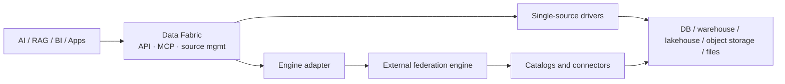

# Data Fabric — Lightweight AI Data Access Gateway

<div align="center">
  
  <p><strong>One lightweight gateway so AI apps can query many enterprise data sources through a shared SQL API — including MCP.</strong></p>
  <p>
    <a href="README_zh.md">简体中文</a> ·
    <a href="#quick-start">Quick Start</a> ·
    <a href="MCP_SERVER.md">MCP</a> ·
    <a href="docs/data-source-support.md">Connector catalog</a> ·
    <a href="https://github.com/RhinoLink-Tech/data-fabric">Star</a>
  </p>
  <p>
    
    
    <a href="https://github.com/RhinoLink-Tech/data-fabric/actions/workflows/go.yml"></a>
  </p>
</div>

**For:** AI agents, RAG, Text-to-SQL, and analytics assistants that need read access to mixed databases, warehouses, lakehouses, object storage, and files.

**Not:** a warehouse, ETL platform, vector store, or model / orchestration layer. Data stays in the systems you already run.

## Why teams use it

| Pain | What Data Fabric does |
| --- | --- |
| Every AI feature invents its own connectors and credentials | Register sources once; apps query through one API |
| Model SQL dialects do not match every engine | Optional translation inside the documented [SQL v1 contract](SQL_TRANSLATION_FEATURES.md) |
| Agents need a safe tool surface | Optional [MCP server](MCP_SERVER.md) for discover → validate → query → fetch batches |
| Cross-source SQL is optional, not default | Single-source drivers by default; plug in Trino / Presto / OpenLooKeng when needed |

## AI application scenarios

- **AI agents:** MCP over local stdio or authenticated Streamable HTTP — discover sources, validate read-only SQL, run queries, fetch batches. See the [MCP guide](MCP_SERVER.md) and [agent skill notes](docs/agent-skill.md).
- **RAG retrieval:** Pull structured / semi-structured records from registered sources. Chunking, embeddings, and ranking stay in your RAG stack.
- **Text-to-SQL:** Route model-generated read-only SQL through one API; translate only within the published compatibility matrix.
- **AI analytics:** Give assistants one entry point; attach a federation engine only for cross-source SQL.

Example: [DeepSeek function-calling](examples/deepseek-agent/README.md).

## How it fits

| Component | Responsibility |
| --- | --- |
| Data Fabric | App-facing API, source lifecycle, diagnostics, query routing, result retrieval |
| Federation engine (optional) | Cross-catalog planning and execution |
| Source systems | Store and manage the data |



## Capabilities

- Data-source lifecycle: create, inspect, update, activate, deactivate, delete
- Driver registry for extending source types
- Connection tests, config validation, pool stats, health checks
- Unified query API with batched (and streaming-capable) result retrieval
- SQL dialect adaptation within the [SQL v1 matrix](SQL_TRANSLATION_FEATURES.md)
- Security: JWT APIs, OIDC for remote MCP, owner/tenant and table/column policies, redacted audit events, read-only SQL validation, TLS verification for PostgreSQL / openGauss / MySQL / MariaDB / TiDB, rate limits
- Prometheus metrics at `/metrics` (admin Bearer JWT required) — [observability guide](docs/observability.md)

## Data sources and honesty about support

Data Fabric publishes a **support catalog** that separates *registered implementation* from *end-to-end verified* support, and declared version ranges from exact versions tested. A successful connection test alone is not a verification claim. Some connectors are experimental.

Before you rely on a connector, read the [Data Source Support Catalog](docs/data-source-support.md) and [Ozone support status](docs/ozone-support.md).

The standard build ships as one executable with registered drivers compiled in; connections open only for configured sources.

## SQL v1 (short)

SQL v1 is a shared **read-only** profile for common `SELECT` workloads — not a new dialect and not a claim of full SQL:2023 conformance. Covered shapes include projections, `WHERE`, `INNER`/`LEFT JOIN`, `GROUP BY` / aggregates, `HAVING`, `ORDER BY`, `LIMIT`/`OFFSET`, and `UNION`, within the documented examples.

Pass `sourceDialect` to translate inside the [compatibility matrix](SQL_TRANSLATION_FEATURES.md); omit it to send native SQL to the target. Engine-specific functions, CTEs, windows, complex types, and time-travel have no shared translation guarantee.

## Quick Start

### Requirements

- Go **1.26.1+** (from source) or Docker Engine (container build)
- A reachable **metadata database**
- Network access to the sources you will register
- `JWT_SECRET` (≥ 32 bytes) and a credential-encryption keyring via env vars

> There is **no published one-command Compose stack or prebuilt public image yet**. You build locally and bring your own metadata DB. That is the main friction today.

### Run from source

```bash
git clone https://github.com/RhinoLink-Tech/data-fabric.git
cd data-fabric
cp configs/config.yaml.example configs/config.yaml
go mod download
```

Edit `configs/config.yaml` for the metadata database, then:

```bash
export JWT_SECRET="$(openssl rand -hex 32)"
export DATA_FABRIC_CREDENTIAL_ACTIVE_KEY_ID=dev-v1
export DATA_FABRIC_CREDENTIAL_KEYS="{\"dev-v1\":\"$(openssl rand -base64 32)\"}"
go run ./cmd/server
```

Reuse the same secrets across restarts. Health check: `GET /health`. More detail: [configuration guide](docs/configuration.md).

### Build and run with Docker

Create the MySQL metadata DB/account first, then:

```bash
docker build -t data-fabric:local .
docker run --rm --name data-fabric \
  --add-host=host.docker.internal:host-gateway \
  -p 8080:8080 \
  -e DATABASE_HOST=host.docker.internal \
  -e DATABASE_PORT=3306 \
  -e DATABASE_DATABASE=data_fabric \
  -e DATABASE_USERNAME=data_fabric \
  -e DATABASE_PASSWORD="<metadata database password>" \
  -e SECURITY_JWT_SECRET="<stable secret with at least 32 bytes>" \
  -e DATA_FABRIC_CREDENTIAL_ACTIVE_KEY_ID=dev-v1 \
  -e DATA_FABRIC_CREDENTIAL_KEYS='{"dev-v1":"<base64-encoded 32-byte key>"}' \
  data-fabric:local
```

The image listens on **8080** as a non-root user and takes config from environment variables.

## Performance expectations

Data Fabric is a **gateway**, not a query accelerator. Extra cost is the hop plus auth, validation, routing, normalization, and JSON encoding (plus optional dialect conversion). Short queries feel the layer more; long queries are dominated by the engine and data transfer.

Local WSL benchmarks (PostgreSQL, synthetic data) and deployment footprint numbers are documented with limits — not production guarantees, not TPC:

- [PostgreSQL gateway benchmark](docs/performance/postgres-gateway-benchmark.md)
- [Deployment footprint](docs/performance/deployment-footprint.md)

## API overview

| Method | Path | Purpose | Authentication |
| --- | --- | --- | --- |
| GET | `/health` | Service health | None |
| GET | `/api/v1/database/types` | Recognized source types | None |
| GET | `/api/v1/database/compatibility` | Compatibility info | None |
| GET / POST | `/api/v1/datasources` | List or create sources | Bearer when auth enabled; owner/tenant scoped |
| GET / PUT / DELETE | `/api/v1/datasources/:id` | Inspect, update, delete | Same; non-admins get uniform 403 for missing/foreign |
| POST | `/api/v1/datasources/:id/activate` | Activate | Same |
| POST | `/api/v1/datasources/:id/deactivate` | Deactivate | Same |
| POST | `/api/v1/database/test-connection` | Test connection | Bearer when auth enabled |
| POST | `/api/v1/database/validate-config` | Validate config | Bearer when auth enabled |
| GET | `/api/v1/database/health` | All-source health | Admin when auth enabled |
| GET | `/api/v1/database/connections/stats` | Pool stats | Admin when auth enabled |
| POST | `/api/v1/fetch` | Run query, first batch | Bearer always; needs read access |
| GET | `/api/v1/fetch/:query_id/:slug/:token` | Later batches | Bearer always; creator only |

Details: [API usage guide](docs/api_usage.md).

## Documentation

- [API Usage Guide](docs/api_usage.md)
- [MCP Server](MCP_SERVER.md)
- [Data Fabric Agent Skill](docs/agent-skill.md)
- [DeepSeek Function-Calling Example](examples/deepseek-agent/README.md)
- [Architecture](docs/architecture.md)
- [Configuration](docs/configuration.md)
- [Development](docs/development.md)
- [Contributing](CONTRIBUTING.md)
- [Security Policy](SECURITY.md)
- [Support](SUPPORT.md)

## Cross-source query engines

Trino, Presto, and OpenLooKeng adapters can be registered as sources. The support catalog marks them as **implementation-present, not end-to-end verified**. Live coordinator verification is deferred in [#179](https://github.com/RhinoLink-Tech/data-fabric/issues/179).

## Contribute

Issues, pull requests, and docs improvements are welcome — see [CONTRIBUTING.md](CONTRIBUTING.md).

## License

Apache License 2.0. See [LICENSE](LICENSE).
