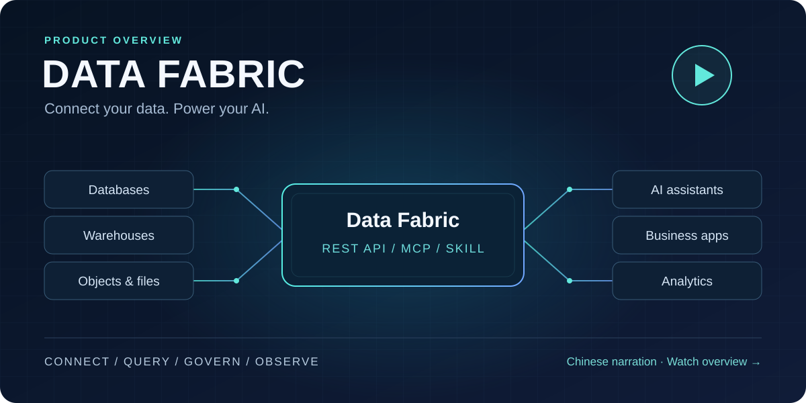
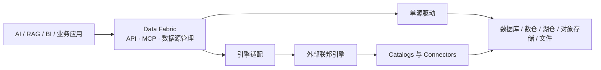

# Data Fabric：面向 AI 应用的轻量数据接入网关

<div align="center">
  
  <p><strong>一个轻量网关，让 AI 应用通过统一 SQL API（含 MCP）访问多种企业数据源。</strong></p>
  <p>
    <a href="README.md">English</a> ·
    <a href="#快速开始">快速开始</a> ·
    <a href="MCP_SERVER.md">MCP</a> ·
    <a href="docs/data-source-support.md">连接器目录</a> ·
    <a href="https://github.com/RhinoLink-Tech/data-fabric">Star</a>
  </p>
  <p>
    
    
    <a href="https://github.com/RhinoLink-Tech/data-fabric/actions/workflows/go.yml"></a>
  </p>
</div>

**适合：** 需要只读访问混合数据库、数仓、湖仓、对象存储和文件的 AI Agent、RAG、Text-to-SQL 与智能分析场景。

**不是：** 数仓、ETL、向量库，也不接管模型推理或 AI 编排。数据仍留在你现有系统里。

## 为什么用它

| 痛点 | Data Fabric 怎么解决 |
| --- | --- |
| 每个 AI 功能各自接库、管凭据 | 数据源登记一次，应用走统一 API |
| 模型 SQL 方言对不上引擎 | 在已文档化的 [SQL v1 合同](SQL_TRANSLATION_FEATURES.md) 内可选转换 |
| Agent 需要安全的工具面 | 可选 [MCP 服务](MCP_SERVER.md)：发现 → 校验 → 查询 → 分批取结果 |
| 跨源 SQL 不是默认刚需 | 默认单源驱动；需要时再接 Trino / Presto / OpenLooKeng |

## 产品能力讲解视频

[](https://scrimba.com/explain/guide0ui5us658?fullscreen=1)

通过中文配音与架构图解，了解部署、数据源管理、统一查询、访问策略、可观测性，以及 Codex、WorkBuddy 的 MCP 与 Skill 接入。具体配置步骤见[部署指南](docs/mcp-deployment-zh.md)和[客户端接入指南](docs/agent-skill-zh.md)。

## AI 应用场景

- **AI Agent：** 本地 stdio 或经认证的 Streamable HTTP MCP — 发现数据源、校验只读 SQL、执行查询、分批取结果；release 模式的远程 MCP 使用 OIDC access token。见 [MCP 指南](MCP_SERVER.md) 与 [Agent Skill](docs/agent-skill.md)。
- **RAG 检索：** 从已登记数据源拉取结构化 / 半结构化记录；切分、Embedding、排序仍在你的 RAG 栈。
- **Text-to-SQL：** 模型生成的只读 SQL 经统一 API 提交，仅在已发布兼容矩阵内转换。
- **AI 智能分析：** 助手共用一个入口；只有跨源 SQL 时再挂联邦引擎。

示例：[DeepSeek 函数调用](examples/deepseek-agent/README.md)。

## 在架构中的位置

| 组成部分 | 职责 |
| --- | --- |
| Data Fabric | 面向应用的 API、数据源生命周期、诊断、查询路由、结果获取 |
| 联邦查询引擎（可选） | 跨目录规划与执行 |
| 原始数据系统 | 保存和管理数据 |



## 核心能力

- 数据源生命周期：创建、查看、更新、启用、停用、删除
- 驱动注册与扩展
- 连接测试、配置校验、连接池统计、健康检查
- 统一查询 API，支持分批（及可流式）取结果
- SQL 方言适配（见 [SQL v1 矩阵](SQL_TRANSLATION_FEATURES.md)）
- 安全：JWT API、远程 MCP 的 OIDC、所有者/租户与表列策略、脱敏审计、只读 SQL 校验；PostgreSQL / openGauss / MySQL / MariaDB / TiDB 服务端证书校验；限流
- Prometheus：`/metrics`（始终需要管理员 Bearer JWT）— [可观测性指南](docs/observability.md)

## 数据源与支持声明

Data Fabric 通过数据库类型和兼容性 API 发布共享的数据源支持目录。目录区分已登记实现与端到端验证、声明的版本范围与精确测试版本，也区分协议 fixture 与真实服务证据。版本范围为空表示尚未建立兼容范围；连接测试成功本身不代表已完成端到端验证。部分已登记实现仍处于实验状态。选择连接器前请查看[数据源支持目录](docs/data-source-support.md)和[Ozone 支持状态](docs/ozone-support.md)。

标准构建为单可执行文件，注册驱动编译进二进制；只有实际配置并使用的数据源才会建连。

## SQL v1（摘要）

SQL v1 是面向常见 `SELECT` 工作负载的统一**只读**子集——不是新方言，也不宣称完整符合 SQL:2023。覆盖投影、`WHERE`、`INNER`/`LEFT JOIN`、`GROUP BY`/聚合、`HAVING`、`ORDER BY`、`LIMIT`/`OFFSET`、`UNION` 等（以文档样例为准）。

传入 `sourceDialect` 时在 [兼容矩阵](SQL_TRANSLATION_FEATURES.md) 内转换；省略则按目标引擎原生 SQL 提交。引擎专有函数、CTE、窗口、复杂类型、时间旅行等无统一转换保证。

## 快速开始

当前公开预览版为 [v2.1.0-preview.1](https://github.com/RhinoLink-Tech/data-fabric/releases/tag/v2.1.0-preview.1)，提供 digest 固定的 `linux/amd64` 镜像。建议按 [v2.1.0-preview.1 发布镜像安装指南](docs/releases/v2.1.0-preview.1-install-zh.md)操作；完整 digest 和验收范围见 Release。源码构建仍适用于开发和本地修改。

示例配置使用 MySQL 元数据数据库，并由 REST 与 MCP 两个独立进程共享；预置数据为合成数据。它演示已记录的路径，不证明外部团队采用、生产容量或 SLA。请同时查看[首个采用者画像](docs/product/first-adopter-profile.md)（当前仍是待验证假设）、[数据源支持目录](docs/data-source-support.md)和[当前运行边界](docs/roadmap.md#current-operating-limits)。

该 Preview profile 面向单机部署，不承诺 HA、SLA 或生产就绪。发布镜像路径要求 Docker Engine 24 或更高版本、Docker Compose 2.24 或更高版本、OpenSSL、带标准库的 Python 3，以及能够为已配置受众和查询 scope 签发 access token 的 OIDC 身份提供方；无需在宿主机安装 Go 或 Python 第三方包。

### 从源码运行网关用于开发

直接从源码运行需要 Go 1.26.1 或更高版本、Python 3、可访问的 MySQL 元数据数据库，以及到计划使用的数据源的网络连通性。只读 SQL 分析和方言转换默认使用 SQLGlot 运行时。从仓库根目录在虚拟环境中安装锁定的 parser 依赖：

```bash
python3 -m venv .venv
. .venv/bin/activate
python -m pip install -r requirements-sql-translation.txt
go mod download
cp configs/config.yaml.example configs/config.yaml
```

在 configs/config.yaml 中设置元数据数据库字段。通过环境变量或密钥管理器注入稳定的 JWT 密钥和凭证密钥环；服务重启时必须继续使用相同密钥环，才能解密已保存的数据源凭证。

```bash
export SECURITY_JWT_SECRET="<稳定且至少 32 字节的密钥>"
export DATA_FABRIC_CREDENTIAL_ACTIVE_KEY_ID=dev-v1
export DATA_FABRIC_CREDENTIAL_KEYS='{"dev-v1":"<base64 编码的 32 字节密钥>"}'
go run ./cmd/server
```

可使用 openssl rand -hex 32 和 openssl rand -base64 32 生成密钥；应安全保存，切勿在每次重启时重新生成。健康检查：`GET /health`，更多配置见 [配置指南](docs/configuration.md)。管理 API 的配置及查询请求见 [API 使用指南](docs/api_usage.md)。部署受保护的远程 MCP 时，请使用上面的 OIDC profile；REST 管理 JWT 与身份提供方签发的 MCP access token 是两种不同凭据。

## 性能预期

Data Fabric 是**网关**，不是查询加速器。额外开销来自链路与认证、校验、路由、归一化、JSON 编码（以及可选的方言转换）。短查询更能感知这一层；长查询通常由引擎与数据传输主导。

本机 WSL 基准与部署资源数据见下列报告（含限制说明；非生产保证，非 TPC）：

- [PostgreSQL 网关基准](docs/performance/postgres-gateway-benchmark.md)
- [部署资源基线](docs/performance/deployment-footprint.md)

## API 概览

| 方法 | 路径 | 用途 | 认证 |
| --- | --- | --- | --- |
| GET | `/health` | 健康检查 | 无 |
| GET | `/api/v1/database/types` | 识别的数据源类型 | 无 |
| GET | `/api/v1/database/compatibility` | 兼容性信息 | 无 |
| GET / POST | `/api/v1/datasources` | 列出或创建数据源 | 开启认证时 Bearer；按所有者/租户隔离 |
| GET / PUT / DELETE | `/api/v1/datasources/:id` | 查看、更新、删除 | 同上；非管理员对缺失/他人资源统一 403 |
| POST | `/api/v1/datasources/:id/activate` | 启用 | 同上 |
| POST | `/api/v1/datasources/:id/deactivate` | 停用 | 同上 |
| POST | `/api/v1/database/test-connection` | 测试连接 | 开启认证时 Bearer |
| POST | `/api/v1/database/validate-config` | 校验配置 | 开启认证时 Bearer |
| GET | `/api/v1/database/health` | 全量健康探测 | 开启认证时仅 admin |
| GET | `/api/v1/database/connections/stats` | 连接池统计 | 开启认证时仅 admin |
| POST | `/api/v1/fetch` | 执行查询并取首批结果 | 始终 Bearer；需读权限 |
| GET | `/api/v1/fetch/:query_id/:slug/:token` | 后续批次 | 始终 Bearer；仅创建者可续拉 |

请求字段、响应结构和认证行为见 [API 使用指南](docs/api_usage.md)，数据源授权模型见 [配置文档](docs/configuration.md#data-source-authorization)。
自托管的数据源管理页面位于 /ui/，使用说明见[数据源管理界面文档](docs/data-source-management-ui-zh.md)。

## 项目文档

- [API 使用指南](docs/api_usage.md)
- [MCP Server](MCP_SERVER.md)
- [数据源管理界面](docs/data-source-management-ui-zh.md)
- [Codex 与 WorkBuddy 的 Data Fabric Skill 接入](docs/agent-skill-zh.md)
- [DeepSeek 函数调用示例](examples/deepseek-agent/README.md)
- [架构设计](docs/architecture.md)
- [产品路线图](docs/roadmap.md)
- [采用与产品价值执行计划](docs/plans/gateway-delivery.md)
- [首个采用者与支持画像](docs/product/first-adopter-profile.md)（英文；当前假设，外部验证仍待完成）
- [开源采用与产品价值演进计划](docs/plans/gateway-delivery.md#productization-program)（交付与验证规划中）
- [配置指南](docs/configuration.md)
- [开发指南](docs/development.md)
- [贡献指南](CONTRIBUTING.md)
- [安全政策](SECURITY.md)
- [获取帮助](SUPPORT.md)

## 跨源查询引擎

需要跨源 SQL 时，Data Fabric 可通过统一适配接入兼容的联邦查询引擎。Trino、Presto 和 OpenLooKeng 适配器已实现并可登记为数据源。支持目录记录版本固定的驱动契约证据，目前仍将这三个适配器标为“已实现”。另有可选的 [Trino 484 集成验证配置](docs/validation/trino-integration.md)，通过公开 REST 和 MCP 接口覆盖报告列出的只读跨目录查询、超时、协调器恢复和引擎错误路径。该有限范围不证明其他 Trino 版本、认证方式、连接器、SQL 功能、worker 拓扑或生产工作负载的兼容性。

连接配置见 [API 使用指南](docs/api_usage.md)，SQL 兼容范围见[统一 SQL v1 说明](SQL_TRANSLATION_FEATURES.md)。

## 参与贡献

欢迎 Issue、Pull Request 与文档改进，详见 [CONTRIBUTING.md](CONTRIBUTING.md)。

## 许可证

Apache License 2.0，见 [LICENSE](LICENSE)。
