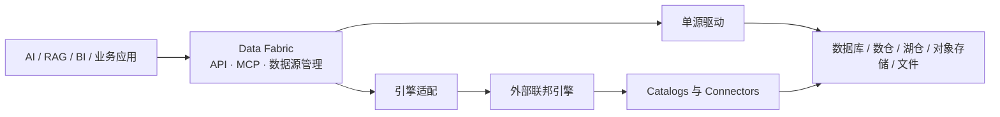

# Data Fabric：面向 AI 应用的轻量数据接入网关

<div align="center">
  
  <p><strong>一个轻量网关，让 AI 应用通过统一 SQL API（含 MCP）访问多种企业数据源。</strong></p>
  <p>
    <a href="README.md">English</a> ·
    <a href="#快速开始">快速开始</a> ·
    <a href="MCP_SERVER.md">MCP</a> ·
    <a href="docs/data-source-support.md">连接器目录</a> ·
    <a href="https://github.com/RhinoLink-Tech/data-fabric">Star</a>
  </p>
  <p>
    
    
    <a href="https://github.com/RhinoLink-Tech/data-fabric/actions/workflows/go.yml"></a>
  </p>
</div>

**适合：** 需要只读访问混合数据库、数仓、湖仓、对象存储和文件的 AI Agent、RAG、Text-to-SQL 与智能分析场景。

**不是：** 数仓、ETL、向量库，也不接管模型推理或 AI 编排。数据仍留在你现有系统里。

## 为什么用它

| 痛点 | Data Fabric 怎么解决 |
| --- | --- |
| 每个 AI 功能各自接库、管凭据 | 数据源登记一次，应用走统一 API |
| 模型 SQL 方言对不上引擎 | 在已文档化的 [SQL v1 合同](SQL_TRANSLATION_FEATURES.md) 内可选转换 |
| Agent 需要安全的工具面 | 可选 [MCP 服务](MCP_SERVER.md)：发现 → 校验 → 查询 → 分批取结果 |
| 跨源 SQL 不是默认刚需 | 默认单源驱动；需要时再接 Trino / Presto / OpenLooKeng |

## AI 应用场景

- **AI Agent：** 本地 stdio 或经认证的 Streamable HTTP MCP — 发现数据源、校验只读 SQL、执行查询、分批取结果。见 [MCP 指南](MCP_SERVER.md) 与 [Agent Skill](docs/agent-skill.md)。
- **RAG 检索：** 从已登记数据源拉取结构化 / 半结构化记录；切分、Embedding、排序仍在你的 RAG 栈。
- **Text-to-SQL：** 模型生成的只读 SQL 经统一 API 提交，仅在已发布兼容矩阵内转换。
- **AI 智能分析：** 助手共用一个入口；只有跨源 SQL 时再挂联邦引擎。

示例：[DeepSeek 函数调用](examples/deepseek-agent/README.md)。

## 在架构中的位置

| 组成部分 | 职责 |
| --- | --- |
| Data Fabric | 面向应用的 API、数据源生命周期、诊断、查询路由、结果获取 |
| 联邦查询引擎（可选） | 跨目录规划与执行 |
| 原始数据系统 | 保存和管理数据 |



## 核心能力

- 数据源生命周期：创建、查看、更新、启用、停用、删除
- 驱动注册与扩展
- 连接测试、配置校验、连接池统计、健康检查
- 统一查询 API，支持分批（及可流式）取结果
- SQL 方言适配（见 [SQL v1 矩阵](SQL_TRANSLATION_FEATURES.md)）
- 安全：JWT API、远程 MCP 的 OIDC、所有者/租户与表列策略、脱敏审计、只读 SQL 校验；PostgreSQL / openGauss / MySQL / MariaDB / TiDB 服务端证书校验；限流
- Prometheus：`/metrics`（始终需要管理员 Bearer JWT）— [可观测性指南](docs/observability.md)

## 数据源与支持声明

项目通过**支持目录**区分「已注册实现」与「端到端验证」，以及声明版本范围与精确测试版本。连接测试成功本身不等于端到端验证；部分连接器仍为实验性。

选用前请阅读 [数据源支持目录](docs/data-source-support.md) 与 [Ozone 支持状态](docs/ozone-support.md)。

标准构建为单可执行文件，注册驱动编译进二进制；只有实际配置并使用的数据源才会建连。

## SQL v1（摘要）

SQL v1 是面向常见 `SELECT` 工作负载的统一**只读**子集——不是新方言，也不宣称完整符合 SQL:2023。覆盖投影、`WHERE`、`INNER`/`LEFT JOIN`、`GROUP BY`/聚合、`HAVING`、`ORDER BY`、`LIMIT`/`OFFSET`、`UNION` 等（以文档样例为准）。

传入 `sourceDialect` 时在 [兼容矩阵](SQL_TRANSLATION_FEATURES.md) 内转换；省略则按目标引擎原生 SQL 提交。引擎专有函数、CTE、窗口、复杂类型、时间旅行等无统一转换保证。

## 快速开始

### 环境要求

- 源码运行：Go **1.26.1+**；或使用 Docker Engine 构建容器
- 可访问的**元数据数据库**
- 能访问计划登记的数据源
- 通过环境变量提供 `JWT_SECRET`（≥ 32 字节）与凭证加密密钥环

> 目前**没有**现成的一键 Compose，也**没有**公开发布的预构建镜像。需要本地构建，并自备元数据库——这是当前最大的上手摩擦。

### 本地源码运行

```bash
git clone https://github.com/RhinoLink-Tech/data-fabric.git
cd data-fabric
cp configs/config.yaml.example configs/config.yaml
go mod download
```

在 `configs/config.yaml` 中配置元数据库，然后：

```bash
export JWT_SECRET="$(openssl rand -hex 32)"
export DATA_FABRIC_CREDENTIAL_ACTIVE_KEY_ID=dev-v1
export DATA_FABRIC_CREDENTIAL_KEYS="{\"dev-v1\":\"$(openssl rand -base64 32)\"}"
go run ./cmd/server
```

重启请复用同一套密钥。健康检查：`GET /health`。详见 [配置指南](docs/configuration.md)。

### Docker 构建与运行

先创建 MySQL 元数据库与账号，再：

```bash
docker build -t data-fabric:local .
docker run --rm --name data-fabric \
  --add-host=host.docker.internal:host-gateway \
  -p 8080:8080 \
  -e DATABASE_HOST=host.docker.internal \
  -e DATABASE_PORT=3306 \
  -e DATABASE_DATABASE=data_fabric \
  -e DATABASE_USERNAME=data_fabric \
  -e DATABASE_PASSWORD="<元数据库密码>" \
  -e SECURITY_JWT_SECRET="<至少 32 字节且稳定的密钥>" \
  -e DATA_FABRIC_CREDENTIAL_ACTIVE_KEY_ID=dev-v1 \
  -e DATA_FABRIC_CREDENTIAL_KEYS='{"dev-v1":"<base64 编码的 32 字节密钥>"}' \
  data-fabric:local
```

镜像默认监听 **8080**，非 root 运行，配置来自环境变量。

## 性能预期

Data Fabric 是**网关**，不是查询加速器。额外开销来自链路与认证、校验、路由、归一化、JSON 编码（以及可选的方言转换）。短查询更能感知这一层；长查询通常由引擎与数据传输主导。

本机 WSL 基准与部署资源数据见下列报告（含限制说明；非生产保证，非 TPC）：

- [PostgreSQL 网关基准](docs/performance/postgres-gateway-benchmark.md)
- [部署资源基线](docs/performance/deployment-footprint.md)

## API 概览

| 方法 | 路径 | 用途 | 认证 |
| --- | --- | --- | --- |
| GET | `/health` | 健康检查 | 无 |
| GET | `/api/v1/database/types` | 识别的数据源类型 | 无 |
| GET | `/api/v1/database/compatibility` | 兼容性信息 | 无 |
| GET / POST | `/api/v1/datasources` | 列出或创建数据源 | 开启认证时 Bearer；按所有者/租户隔离 |
| GET / PUT / DELETE | `/api/v1/datasources/:id` | 查看、更新、删除 | 同上；非管理员对缺失/他人资源统一 403 |
| POST | `/api/v1/datasources/:id/activate` | 启用 | 同上 |
| POST | `/api/v1/datasources/:id/deactivate` | 停用 | 同上 |
| POST | `/api/v1/database/test-connection` | 测试连接 | 开启认证时 Bearer |
| POST | `/api/v1/database/validate-config` | 校验配置 | 开启认证时 Bearer |
| GET | `/api/v1/database/health` | 全量健康探测 | 开启认证时仅 admin |
| GET | `/api/v1/database/connections/stats` | 连接池统计 | 开启认证时仅 admin |
| POST | `/api/v1/fetch` | 执行查询并取首批结果 | 始终 Bearer；需读权限 |
| GET | `/api/v1/fetch/:query_id/:slug/:token` | 后续批次 | 始终 Bearer；仅创建者可续拉 |

详情见 [API 使用指南](docs/api_usage.md)。

## 项目文档

- [API 使用指南](docs/api_usage.md)
- [MCP Server](MCP_SERVER.md)
- [Data Fabric Agent Skill](docs/agent-skill.md)
- [DeepSeek 函数调用示例](examples/deepseek-agent/README.md)
- [架构设计](docs/architecture.md)
- [配置指南](docs/configuration.md)
- [开发指南](docs/development.md)
- [贡献指南](CONTRIBUTING.md)
- [安全政策](SECURITY.md)
- [获取帮助](SUPPORT.md)

## 跨源查询引擎

可登记 Trino、Presto、OpenLooKeng 适配器。支持目录将其标为**已实现、尚未端到端验证**。真实协调器验证见 [#179](https://github.com/RhinoLink-Tech/data-fabric/issues/179)。

## 参与贡献

欢迎 Issue、Pull Request 与文档改进，详见 [CONTRIBUTING.md](CONTRIBUTING.md)。

## 许可证

Apache License 2.0，见 [LICENSE](LICENSE)。
